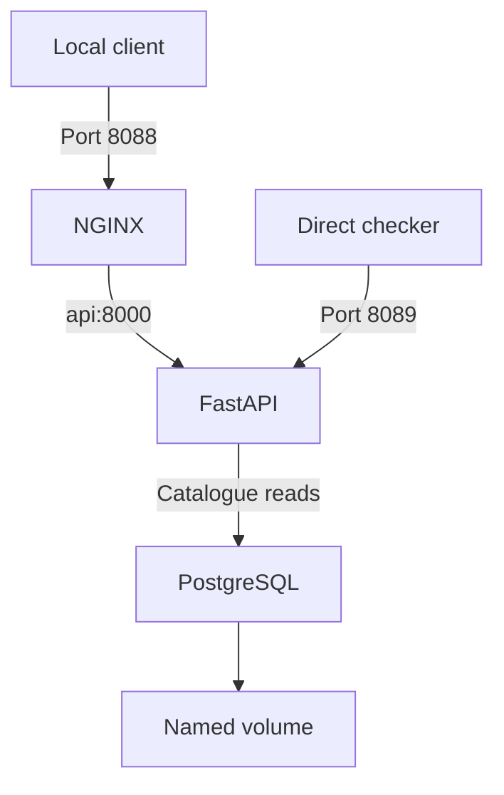

# Architecture

Phase 2 merged at `e960f68` after 153 tests and three live deployment exercises.
The Phase 3 live runs on 22 November 2026 covered manual selection of a
recorded v1 release, reconciliation after controlled toolkit exits and opt-in
automatic recovery from a failed candidate. The final run verified v1 through
both HTTP routes and retained the database and proxy container IDs.
[Phase 3 verification](PHASE-3-RECOVERY.md#combined-live-results)

## Purpose and scope

Build a Python command-line tool that deploys a specific application image,
checks essential behavior, and supports recovery to a previous compatible
application release. Its demonstration workload is a minimal read-only
catalogue backed by PostgreSQL and accessed through NGINX.

The baseline targets one Linux host and one dedicated Docker Compose project.
It requires no paid service, expiring trial, or additional VM. The original diet
and medical repositories and their Docker resources remain outside its control.

## Implemented demo

| Component | Implementation |
|---|---|
| API | FastAPI in a non-root Python container; read-only root filesystem |
| Database | PostgreSQL 18 with a dedicated named volume |
| Proxy | NGINX forwarding to the Compose service `api` |
| Initialization | Explicit one-off `init` service using the API image |
| Demo unit tests | Four API failure tests and five smoke-checker regression tests |
| Live checker | `tests/smoke.py`, run on the host |

The Compose project is `sdt-demo`; its database volume is
`sdt-demo_catalogue_data`, mounted at `/var/lib/postgresql`.
NGINX publishes `127.0.0.1:8088`; the API publishes `127.0.0.1:8089` for direct
checks. PostgreSQL is reachable inside the Compose network, with no host-port
publication. None of these containers mounts the Docker socket.

Requests through NGINX follow this path:

NGINX uses Docker's network DNS resolver for the variable upstream, with a
five-second validity setting. Replacement checks passed, but a changed upstream
IP address was not explicitly established by those tests. This is not a
zero-downtime routing guarantee.

## API and database behavior

| Endpoint | Current behavior |
|---|---|
| `GET /items` | Selects `id` and `name`, ordered by ID, limited to 100 rows |
| `GET /health/live` | Returns liveness without a database request |
| `GET /health/ready` | Attempts to read the required table; an empty accessible table can pass |
| `GET /version` | Returns the release string loaded from `app/release.txt` |

Database errors caught by the API return HTTP 503 with the generic detail
`Catalogue unavailable`. Missing configuration and arbitrary programming errors
are not covered by that database-error handler.

The API uses `catalogue_reader`. It requests read-only transactions, and the
initialization code grants SELECT on `public.items`. INSERT, UPDATE, and DELETE
were independently denied during tests with read-write transactions enabled.
This does not claim that the role has no other PostgreSQL privileges.

Initialization connects as `catalogue_admin` and creates the fixed table if
absent. It inserts missing fixture IDs without overwriting existing rows, then
verifies the expected values. Conflicting fixtures cause failure. The operation
also configures the reader role's password and grants within the transaction.
It does not validate every aspect of an arbitrary pre-existing schema, migrate
schemas, or provide credential rotation.

The API has no write endpoints or individual-user accounts. All records are
synthetic catalogue items; this is not a healthcare application.

## Startup and current verification

Compose waits for PostgreSQL's server health check before starting the API.
The API container health check uses liveness, not database readiness. NGINX
waits for API liveness and has no configured container health check of its own.
Database initialization is an explicit action, not an API-startup side effect.

The smoke checker validates status codes and JSON bodies for all four endpoints
at both addresses. Normal mode expects exactly the three fixture records;
`--database-down` expects liveness/version to work and readiness/items to return
HTTP 503. It uses explicit comparisons, including under Python optimization.
It has a 12-second per-request socket timeout and a response-size limit, but
no retries or overall operation deadline. This is a small test helper, not the
deployment verifier in `toolkit/checks.py`.

The image installs 16 pinned runtime packages from `demo/requirements.lock`.
A separate 19-package development lock includes the test client and its
additional dependencies. Base-image references are digest-pinned. The working
application tag `sdt-demo-api:phase1` remains mutable.

## Deployment verification

Batch D implements the five check groups below and integrates preflight and
operation recording under the mutation lock. Success is a point-in-time result;
real Docker acceptance remains separate from simulated tests.

The deployment workflow checks configuration, Docker access, image availability,
resource ownership and recorded operation state while holding its mutation lock.
The standalone `preflight` command only inspects resources and candidate identity;
it does not acquire that lock, check the journal or verify HTTP responses.
The selected image must resolve to an immutable identifier; a mutable tag alone is insufficient.

Five verification groups are implemented:

1. Application container state during the verification window.
2. API liveness.
3. Expected running image identity and application release metadata.
4. A database-backed catalogue response with expected synthetic content.
5. The catalogue response through NGINX.

The verifier shares a monotonic deadline across attempts, caps each request and
Docker query to the remaining budget, and bounds response bodies. HTTP probes
run in child processes; process cleanup has a separate two-second wait budget.
It retries until success or deadline, without accumulating passes across attempts.
Readiness assists startup and diagnosis; it does not replace catalogue checks.
Passing the checks establishes only the tested conditions, not complete
correctness, security, or future availability.

## Recovery policy

Manual rollback is the default. A failed deployment must be reported without
automatically replacing it again; service may remain unavailable until the
operator acts.

Automatic recovery requires explicit opt-in, a previous recorded successful
release whose image is available and running, fresh baseline verification, and
supported image-only changes under unchanged runtime configuration, database
schema and dependency arrangement.
Eligibility relies on declared compatibility and available checks, not proof of
arbitrary compatibility. Missing or inconsistent evidence must prevent automatic
recovery.

Rollback restores an application image, not data, configuration, or dependency
availability. Automatic recovery is attempted at most once per failed deployment
and verified separately. A failed deployment returns a nonzero exit code even
if recovery succeeds. A failed first deployment has no previous release to restore.

## State, interruption handling, and reporting

Mutating toolkit operations must share a lock. This cannot prevent external
Docker commands. Operation progress must be recorded before replacement, and
a failed candidate must not overwrite the previous successful release reference.

Incomplete operations, inconsistent state, or unreadable state require inspection
before further mutations. Unknown state must not be treated as success. Read-only
status and reconciliation preview remain available. A confirmed reconciliation
can close a pending operation as unknown after rechecking it under the same lock.
It preserves the last verified success and can repair the local override when
the pending intended image explains the mismatch with the observed owned API.

Each operation must attempt a small local JSON record and print a concise result.
Deployment and recovery outcomes are separate. Failure evidence must be bounded,
distinguish observations from suspected causes, and avoid secret values, complete
environment dumps, and unfiltered logs. Failure to save a report must be disclosed.

`.runtime/toolkit/` contains operation snapshots and archives when deployment
operations are recorded. Phase 1 test evidence occupies a separate directory. These
records are not a tamper-proof audit trail. See the Phase 2 contract for the
initialization marker, legacy-journal handling and partial-loss limitations.

## Resource and security boundaries

Already configured for the demo:

- Separate Compose project, network, and named database volume.
- Loopback-only published ports; no published PostgreSQL port.
- Non-root API and initializer with read-only root filesystems, dropped
  capabilities, and `no-new-privileges`.
- The generated root `.env` is ignored by Git and lies outside the `demo`
  build context. This does not detect secrets placed in other files or remove
  a secret that was already tracked.

Toolkit boundaries (targeted checks are performed under the deployment lock):

- Operate only on the configured local Docker environment.
- Verify ownership and refuse silent adoption of conflicting resources.
- Perform no global cleanup and delete no database volumes during deployment
  or rollback.
- Do not explicitly change host DNS or firewall settings. Docker may manage
  networking rules during normal operation.
- Keep credentials out of image layers, operation state, and reports.

Docker access grants substantial host control. Trusted local operators,
configuration, and demonstration images are assumed. Environment-based container
credentials remain accessible to sufficiently privileged Docker users; these
boundaries are not a security sandbox.

## Phases and acceptance

0. Foundation: scope, decisions, limitations, README, and ignore rules.
1. Demo stack: startup, repeatable seeding, catalogue access, and health behavior.
2. Deployment: explicit image selection, locking, operation records, and the
   five verification check types.
3. Recovery: manual rollback, eligible automatic recovery, and handling of
   interrupted operations.
4. Diagnostics: DNS/TCP/HTTP observations, structured reports, and reproducible
   failure exercises.
5. Release: clean-install verification, CI evidence, demonstration, and accurate
   documentation.

Tests and documentation develop alongside each phase. Local Phase 1 results
are recorded in [Known issues and limitations](KNOWN-ISSUES.md).

## Out of scope

Kubernetes, Terraform, Jenkins, AI classification, public hosting, application
authentication, real health data, database migrations, database backup and restore,
database rollback, high availability, zero-downtime guarantees, and a web dashboard.

## Approved timeout policy

A deployment-command timeout or other unconfirmed command result starts as an
uncertain outcome, not a confirmed application failure. Batch D cleans up local
command processes as far as possible, keeps pending intent, and attempts up to
ten seconds of read-only observations. Observed image
identity and HTTP results must not silently finalize an uncertain operation.
An operator can close the pending outcome as unknown through reconciliation
before another toolkit mutation. Docker daemon work and children
that deliberately escape the local process group are outside cleanup guarantees.

Inspection, deployment and HTTP-probe commands use isolated process groups and
bounded cleanup.
This is local subprocess handling, not evidence of completed Docker mutations.

## Batch D replacement boundary

The generated override changes only `services.api.image`, using the resolved
full local image ID. Compose receives explicit project/base/override arguments
and `up -d --no-deps --no-build --pull never --force-recreate api`.
Ownership accepts the exact base-file label or, for the API only, the exact
base-plus-toolkit-override label with an image matching the validated override.
Foreign override paths and unexpected override fields are refused.

Two resource snapshots precede pending intent; the second uses the resolved ID.
Only a matching running image takes the verify-only path. The verifier brackets
HTTP checks with container observations and checks that dependency container IDs
have not changed. Brief failures between samples may still escape observation.

Configuration file fingerprints stay in memory and are checked during the
operation. They cover compose.yaml, .env and the NGINX bind-mounted configuration;
they are not persisted secret hashes or a general runtime drift detector. External
Docker commands and file edits can still race with the toolkit. Automatic
recovery adds strict cross-release compatibility checks before the candidate
deployment and again before rollback.

## Manual recovery implementation

`toolkit/compatibility.py` observes the supported input and runtime fields and
computes keyed comparisons. `toolkit/recovery.py` validates history, selects one
full operation ID and evaluates eligibility. The existing deployment function
performs the attempt under the mutation lock and records recovery metadata in
version 3 state. Version 1 and 2 history stays readable.

The `baseline` command explicitly registers a verified running release and its
declared catalogue schema contract. The `targets` command lists recorded
successes with current eligibility reasons. `rollback --to ID --dry-run`
previews the same eligibility logic used by an actual attempt. Full observations
before and after successful verification must agree before a new recovery target
can be recorded. All observations are point-in-time checks.

## Reconciliation and automatic recovery

`toolkit/reconcile.py` inspects pending operations. Confirmation holds the
journal lock, rechecks the exact pending ID and supported resources, and records
the observed API image, container ID and running state. It can align the
generated override with an owned API when the pending replacement explains
the mismatch. A terminal `closed-unknown` record preserves the original intent
and the previous verified success.

The opted-in deployment verifies the last recorded success again before changing
the API. It saves the selected baseline ID in the candidate operation. If Compose
confirms completion and candidate verification fails, the lock remains held.
The toolkit verifies the observed candidate container ID and start time. It
records the failure before checking that the same instance is still current
and that the baseline remains eligible. It renders the stored image override
and repeats the compatibility and resource checks before calling Compose.
An eligible recovery has its own record linked to the immediately preceding
failure. Target selection also validates the links between automatic records.

Version 4 snapshots and records support these outcomes. The current reader also
accepts versions 1–3. The [Phase 3 contract](PHASE-3-RECOVERY.md) records the
checks, exit codes and verification status.
